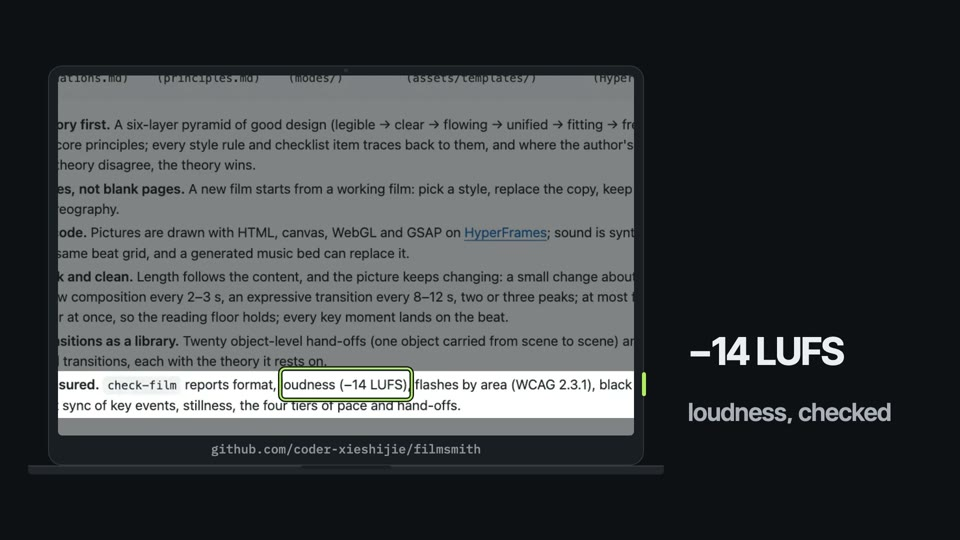
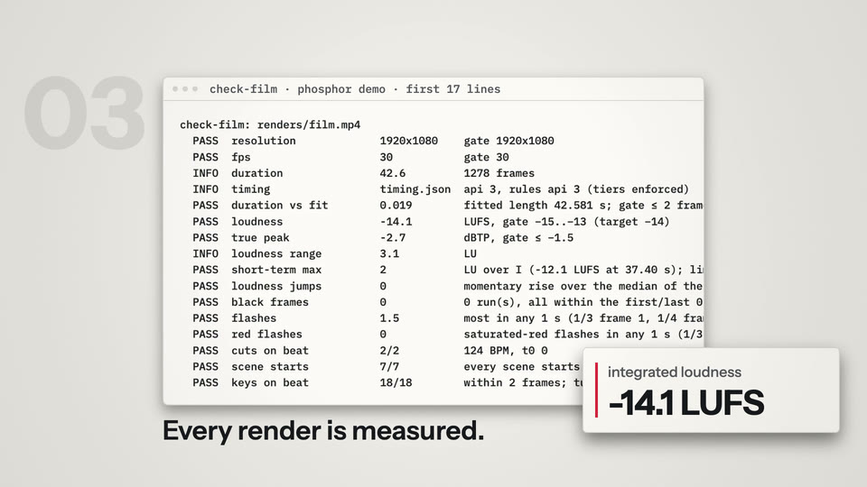
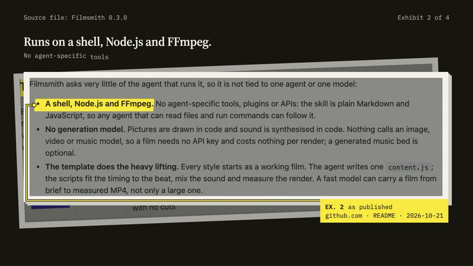
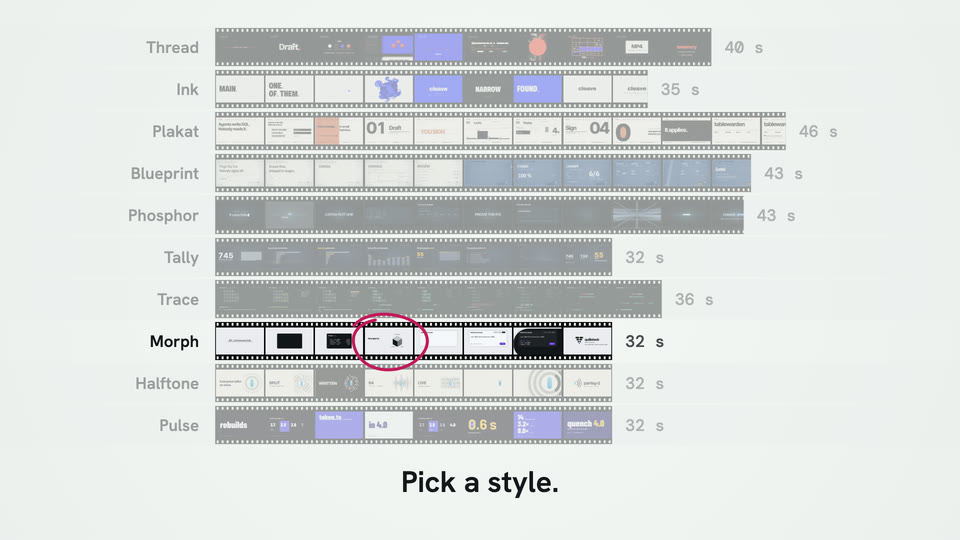
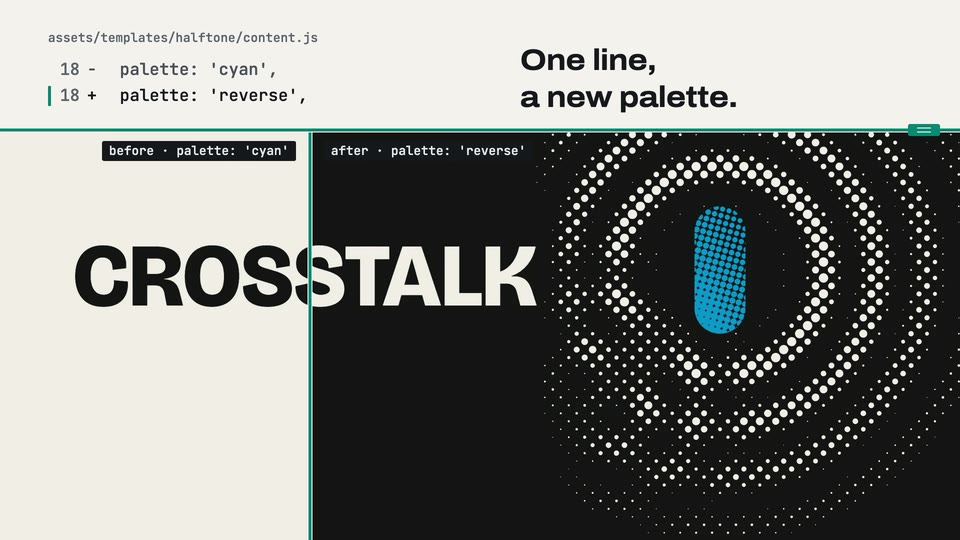
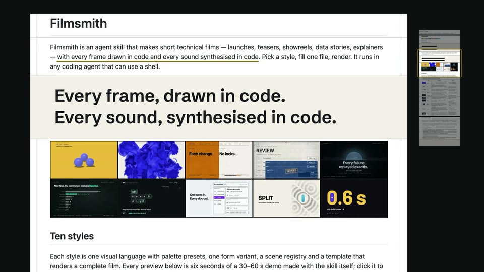

# Filmsmith


[Read in Chinese](README.zh-CN.md)

**Sixteen ways to film your code.**

Filmsmith is an agent skill that makes short technical films — launches, teasers, showreels, data stories, explainers — with every frame drawn in code and every sound synthesised in code. Pick a style, fill one file, render. It runs in any coding agent that can use a shell.


## Sixteen styles

Each style is one visual language with palette presets, one form variant, a scene registry and a template that renders a complete film. Every preview below is six seconds of a 30–60 s demo made with the skill itself; click it to watch the full film with sound on [YouTube](https://www.youtube.com/@world_0618); the MP4s are in the [v0.1.0 release](https://github.com/coder-xieshijie/filmsmith/releases/tag/v0.1.0). The products in the demos are made up, except Tally's, which counts the real Python PEP index. Handset, Exhibit, Dossier, Strip, Split and Scroll film real assets (screenshots, charts, product UI, frames of real films, a product's own pages); their demos are not published yet, so their rows show a still of the shipped example.

| | Style | Looks like | Best for |
|---|---|---|---|
| <a href="https://youtu.be/jqZYCnO05oc"></a> | **[Thread](references/modes/thread.md)** | One line that becomes everything in turn — caret, swatches, storyboard, glossy spheres, edit tracks — with no cuts | Showreels of a video, motion or rendering tool |
| <a href="https://youtu.be/lROE42KoS0Q"></a> | **[Ink](references/modes/ink.md)** | Heavy type slammed on every beat; an ink drop unfurls like sumi in water and floods the frame with colour | Name reveals, launch stings, one-line claims |
| <a href="https://youtu.be/UFWodFOugnc"></a> | **[Plakat](references/modes/plakat.md)** | International-style posters in motion: paper, ink, one signal colour, a visible 12-column grid | A claim plus steps, and the person who decides |
| <a href="https://youtu.be/hEbEtFNLL0w"></a> | **[Blueprint](references/modes/blueprint.md)** | One engineering drawing drafted sheet by sheet; amber stamps approve each part | Systems and workflows with parts and sign-offs |
| <a href="https://youtu.be/UMG08KZZ6IM"></a> | **[Phosphor](references/modes/phosphor.md)** | A night-time terminal running a launch: one phosphor accent, light drawn in code, a HUD frame | CLIs and developer tools |
| <a href="https://youtu.be/KPMS7Bgpflg"></a> | **[Tally](references/modes/tally.md)** | One square per item; the same squares regroup from grid to bars, chart to chart | Counts, shares, dataset stories |
| <a href="https://youtu.be/QjjP1WhNm8w"></a> | **[Trace](references/modes/trace.md)** | A dark live diagram: an algorithm runs and the picture is its state | How a mechanism or algorithm works |
| <a href="https://youtu.be/0AYkyN_dv_Q"></a> | **[Morph](references/modes/morph.md)** | One ink shape that never leaves the frame and climbs a dimension per scene — point, line, plane, solid, interface, mark — with no cuts | Developer tools and interface products: one source becomes every surface |
| <a href="https://youtu.be/raqJMXgK4vU"></a> | **[Halftone](references/modes/halftone.md)** | A two-ink print in motion: newsprint, black and one process ink; a piece of the mark holds still while every world is printed round it, then the camera pulls back to the whole mark | Model and product launches: a few features, one number, the name |
| <a href="https://youtu.be/XrFmTVEyi94"></a> | **[Pulse](references/modes/pulse.md)** | A question run as a query: one word a beat, grounds flipping along one hue, a highlight hopping over real candidates, one whiteout slamming the answer in on the drop | Version releases and benchmark answers: one measured conclusion |
|  | **[Handset](references/modes/handset.md)** | One device, locked off: every change happens on its screen, which shows only real captures — the product's pages, its UI, its docs — pushed in under the zoom cap, with the words in the margin level with the evidence | Launches that can be seen on the product's own surface: a new default in an app, a panel, a price, a line in the docs |
|  | **[Exhibit](references/modes/exhibit.md)** | Real screenshots and charts on a desk under an overhead camera, in three planes (index numbers, the prints, a chip with each print's claim): the camera slides along the row with parallax, pulls back over the whole desk, cuts on a number two sources share, and measures the gap on a chart's own axis | Launches and reports whose claims are printed in tables, charts and product UI |
|  | **[Dossier](references/modes/dossier.md)** | Real pages dealt onto a dark mat like an evidence file: a highlighter strikes each claim where it is printed, a leader ties it to an exhibit sticker with the source and date, and a figure is carried as a paper slip onto a worksheet that does the arithmetic | Launches, reports and changelogs whose claims are already published |
|  | **[Strip](references/modes/strip.md)** | One strip of film through a fixed gate on a light box: real frames of real films stop registered one a beat, a frame punches to a contact sheet whose rows are exactly as long as the films, and a grease pencil rings the take that runs | Reels of a product's real outputs: rendered films, footage, frames to choose from |
|  | **[Split](references/modes/split.md)** | One movable seam divides the frame: what is written on paper on one side, the real frames, renders and reports it makes on the other; every change is a move of the seam, and the climax is one changed line over two renders of the same instant | Developer tools whose input maps line by line to an output: generators, configs, CLIs and their reports |
|  | **[Scroll](references/modes/scroll.md)** | The product's own long page as one paper scroll: flicked up with momentum, it brakes and locks section by section while its headings pin as chapters; an underline marks the line being read and a band repeats it in large type; one row unfolds in place on the demo it describes | Launches told by the product's own README, docs or changelog |

Every style comes in variants: colour presets (Phosphor in ice, green, amber, cyan, violet or coral, for example) and one form axis — Thread's line even or swelled, Ink's type compressed or extended, Plakat square or diagonal, Blueprint in ink or pencil, Phosphor on a CRT raster or a flat panel, Tally in squares, dots or Isotype glyphs, Trace drawn as vectors or sketched, Morph with round or cut corners, Halftone in round, square or line screens, Pulse with cut or round apertures, Handset on a laptop or a phone, Exhibit on a plain desk or a cutting mat, Dossier's highlighter over the claim or under the line, Strip on double- or single-perforation film, Split's seam straight or stitched, Scroll with or without a minimap of the whole page. Each style card lists its use cases with a worked example.

## Any agent, any model

Filmsmith asks very little of the agent that runs it, so it is not tied to one agent or one model:

- **A shell, Node.js and FFmpeg.** No agent-specific tools, plugins or APIs: the skill is plain Markdown and JavaScript, so any agent that can read files and run commands can follow it.
- **No generation model.** Pictures are drawn in code and sound is synthesised in code. Nothing calls an image, video or music model, so a film needs no API key and costs nothing per render; a generated music bed is optional.
- **The template does the heavy lifting.** Every style starts as a working film. The agent writes one `content.js`; the scripts fit the timing to the beat, mix the sound and measure the render. A fast model can carry a film from brief to measured MP4, not only a large one.

## Quick start

Install the skill (the [skills CLI](https://github.com/vercel-labs/skills) asks which agents to install it for; observed 2026-10):

```bash
npx skills add coder-xieshijie/filmsmith
```

Or send this to any coding agent that has a shell:

```text
Install the filmsmith skill: clone https://github.com/coder-xieshijie/filmsmith into your skills folder as filmsmith, then run `node scripts/selftest.mjs --modes ink` inside it and tell me the result.
```

To update later:

```text
Update the filmsmith skill: git pull in its folder, then run `node scripts/selftest.mjs --modes ink` and tell me the latest commit.
```

Or clone and link it yourself:

```bash
git clone https://github.com/coder-xieshijie/filmsmith.git
ln -s "$PWD/filmsmith" <your agent's skills folder>/filmsmith
```

Then, in a new session:

> Use filmsmith. Make a launch video for &lt;your project&gt;. Source: &lt;link or text&gt;.

More things to ask for:

```text
Make a 30-second teaser for our CLI's 2.0 release; the changelog is in CHANGELOG.md.
Turn the numbers in data/survey.csv into a 40-second data film.
Explain how our rate limiter works, step by step, as a 45-second film; the code is in src/limiter.
Restyle last week's launch film as a blueprint and compare the two.
```

The agent proposes a style and a palette, writes a plan, renders key frames for you to check, renders the film and measures it. Under the hood:

```bash
node filmsmith/scripts/new-film.mjs ink my-film --palette cobalt   # scaffold a film from a style
cd my-film && npm run film                                            # fit → audio → check → render
node ../filmsmith/scripts/check-film.mjs renders/film.mp4 --film-dir .
```

Requirements: Node.js 22+, FFmpeg, and network access while a film is set up (fonts, GSAP, the first HyperFrames run). `node scripts/selftest.mjs` checks your machine and all sixteen templates.

## How a film is made

```
theory of taste ──▶ ten principles ──▶ sixteen styles ──▶ template + content.js ──▶ npm run film ──▶ measured MP4
(foundations.md)    (principles.md)    (modes/)              (assets/templates/)        (HyperFrames)    (check-film)
```

- **Theory first.** A six-layer pyramid of good design (legible → clear → flowing → unified → fitting → fresh) gives ten core principles; every style rule and checklist item traces back to them, and where the author's taste and the theory disagree, the theory wins.
- **Styles, not blank pages.** A new film starts from a working film: pick a style, replace the copy, keep the choreography.
- **All code.** Pictures are drawn with HTML, canvas, WebGL and GSAP on [HyperFrames](https://github.com/heygen-com/hyperframes); sound is synthesised on the same beat grid, and a generated music bed can replace it.
- **Brisk and clean.** Length follows the content, and the picture keeps changing: a small change about every beat, a new composition every 2–3 s, an expressive transition every 8–12 s, two or three peaks; at most five words enter at once, so the reading floor holds; every key moment lands on the beat.
- **Transitions as a library.** Fifty object-level hand-offs (one object carried from scene to scene: a word, a ringed number, a long page, a strip of film, a seam) and seventeen frame-level transitions, each with the theory it rests on, grouped by the axis they move on.
- **Measured.** `check-film` reports format, loudness (−14 LUFS), flashes by area (WCAG 2.3.1), black frames, beat sync of key events, stillness, the four tiers of pace and hand-offs.

## What's here

| | |
|---|---|
| [Skill](SKILL.md) | `filmsmith`: the workflow, theory, principles, the sixteen styles and their templates, the transition library, the runtime and the measuring scripts. |

## Limits

- Landscape 16:9 at 1920×1080 only.
- On-screen text is English in this version.

## License

Code, skill and prompts are under the [MIT License](LICENSE). Fonts, GSAP and HyperFrames are downloaded at setup under their own licences: see [THIRD-PARTY.md](THIRD-PARTY.md). Contributions: [CONTRIBUTING.md](CONTRIBUTING.md).
