# Filmsmith


[Read in Chinese](README.zh-CN.md)

**Video skills for coding agents: films drawn in code.**

Filmsmith is a collection of agent skills that make videos with nothing but code: every picture is drawn with HTML, canvas and GSAP on [HyperFrames](https://github.com/heygen-com/hyperframes), and every film is rendered and measured by scripts. Each skill is one folder under [`skills/`](skills/) and installs on its own. They run in any coding agent that can use a shell.

| Skill | Makes |
|---|---|
| [keynote-video](#keynote-video) | Short music-driven films for a technical product — launches, teasers, showreels, data stories — in seventeen styles, with no voice-over |
| [teach-video](#teach-video) | Chinese explainer films that teach one technical idea to developers who know the basics, with a narrated voice-over |

## Install

With the [skills CLI](https://github.com/vercel-labs/skills), which lists the skills in this repository and asks which ones to install and for which agents:

```bash
npx skills add coder-xieshijie/filmsmith                       # choose interactively
npx skills add coder-xieshijie/filmsmith --skill keynote-video  # one skill
```

Or clone the repository once and link the skills you want into your agent's skills folder:

```bash
git clone https://github.com/coder-xieshijie/filmsmith.git
ln -s "$PWD/filmsmith/skills/keynote-video" <your agent's skills folder>/keynote-video
ln -s "$PWD/filmsmith/skills/teach-video" <your agent's skills folder>/teach-video
```

`git pull` in the clone updates every linked skill. If you installed the earlier single skill named `filmsmith`, replace it as described in the [changelog](CHANGELOG.md#from-filmsmith-to-keynote-video).

## keynote-video

**Seventeen ways to film your code.** [`skills/keynote-video`](skills/keynote-video/SKILL.md) makes short technical films — launches, teasers, showreels, data stories, explainers — with every frame drawn in code and every sound synthesised in code. Pick a style, fill one file, render.

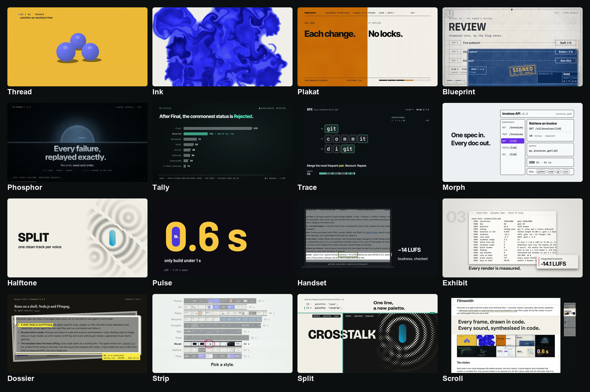

### Seventeen styles

Each style is one visual language with palette presets, one form variant, a scene registry and a template that renders a complete film. Every preview below is six seconds of an existing demo made with the skill itself (28–46 s; Stream's is 92 s). The first ten full films are on [YouTube](https://www.youtube.com/@world_0618), with MP4 downloads in the [v0.1.0 release](https://github.com/coder-xieshijie/filmsmith/releases/tag/v0.1.0); uploads for the six real-asset demos and Stream are pending.

The first ten demos use fictional products except Tally, which counts the real Python PEP index. Handset, Exhibit and Dossier demonstrate real launch pages, charts and product UI captured on October 20, 2026; Strip, Split and Scroll use Filmsmith's own films, code and repository captures from October 21. Stream's demo is a made-up agent desk, Skein, in an English and a Chinese version. Figures, offers and the ten-style README visible in these films belong to those source snapshots. The overview images show the first sixteen styles (Stream is not in them yet); the preserved demos may use earlier palette presets.


| | Style | Looks like | Best for |
|---|---|---|---|
| <a href="https://youtu.be/jqZYCnO05oc"></a> | **[Thread](skills/keynote-video/references/modes/thread.md)** | One line that becomes everything in turn — caret, swatches, storyboard, glossy spheres, edit tracks — with no cuts | Showreels of a video, motion or rendering tool |
| <a href="https://youtu.be/lROE42KoS0Q">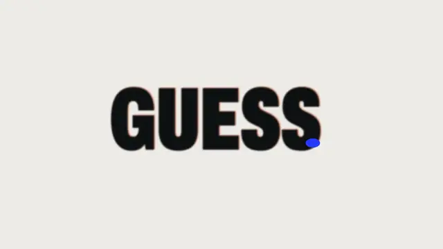</a> | **[Ink](skills/keynote-video/references/modes/ink.md)** | Heavy type slammed on every beat; an ink drop unfurls like sumi in water and floods the frame with colour | Name reveals, launch stings, one-line claims |
| <a href="https://youtu.be/UFWodFOugnc">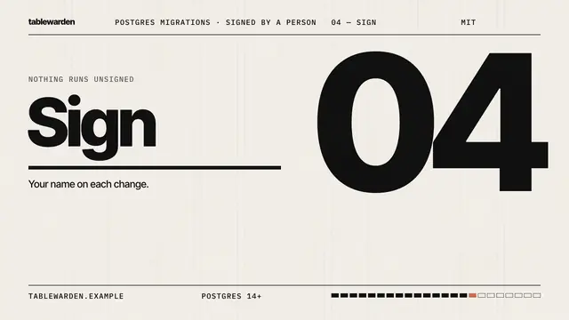</a> | **[Plakat](skills/keynote-video/references/modes/plakat.md)** | International-style posters in motion: paper, ink, one signal colour, a visible 12-column grid | A claim plus steps, and the person who decides |
| <a href="https://youtu.be/hEbEtFNLL0w">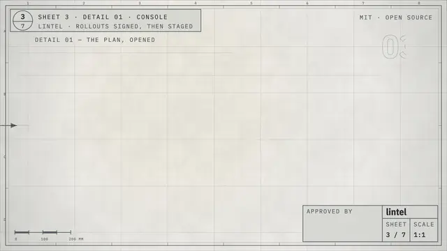</a> | **[Blueprint](skills/keynote-video/references/modes/blueprint.md)** | One engineering drawing drafted sheet by sheet; amber stamps approve each part | Systems and workflows with parts and sign-offs |
| <a href="https://youtu.be/UMG08KZZ6IM">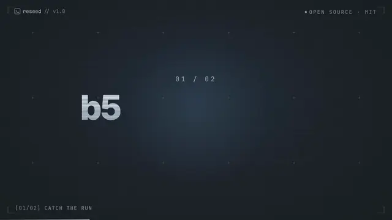</a> | **[Phosphor](skills/keynote-video/references/modes/phosphor.md)** | A night-time terminal running a launch: one phosphor accent, light drawn in code, a HUD frame | CLIs and developer tools |
| <a href="https://youtu.be/KPMS7Bgpflg">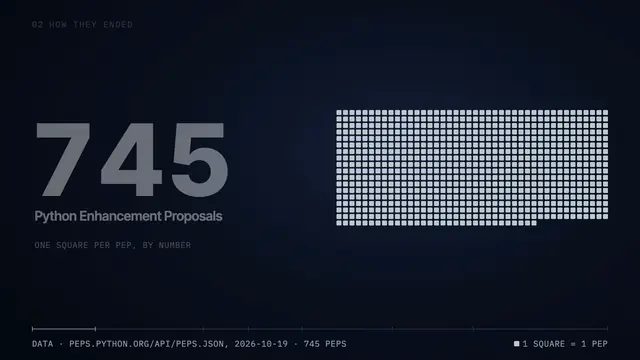</a> | **[Tally](skills/keynote-video/references/modes/tally.md)** | One square per item; the same squares regroup from grid to bars, chart to chart | Counts, shares, dataset stories |
| <a href="https://youtu.be/QjjP1WhNm8w">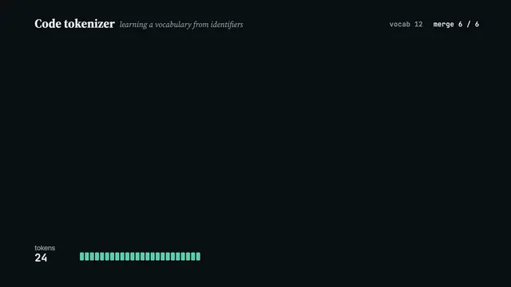</a> | **[Trace](skills/keynote-video/references/modes/trace.md)** | A dark live diagram: an algorithm runs and the picture is its state | How a mechanism or algorithm works |
| <a href="https://youtu.be/0AYkyN_dv_Q">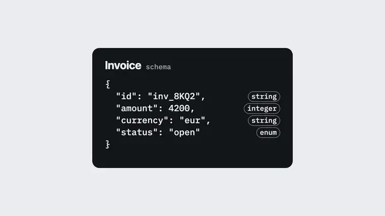</a> | **[Morph](skills/keynote-video/references/modes/morph.md)** | One ink shape that never leaves the frame and climbs a dimension per scene — point, line, plane, solid, interface, mark — with no cuts | Developer tools and interface products: one source becomes every surface |
| <a href="https://youtu.be/raqJMXgK4vU">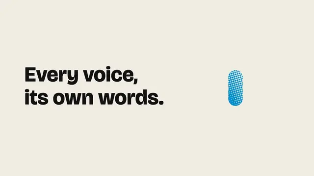</a> | **[Halftone](skills/keynote-video/references/modes/halftone.md)** | A two-ink print in motion: newsprint, black and one process ink; a piece of the mark holds still while every world is printed round it, then the camera pulls back to the whole mark | Model and product launches: a few features, one number, the name |
| <a href="https://youtu.be/XrFmTVEyi94">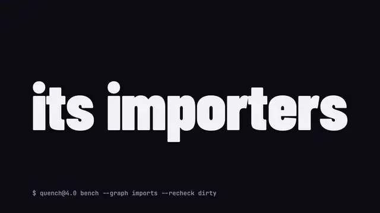</a> | **[Pulse](skills/keynote-video/references/modes/pulse.md)** | A question run as a query: one word a beat, grounds flipping along one hue, a highlight hopping over real candidates, one whiteout slamming the answer in on the drop | Version releases and benchmark answers: one measured conclusion |
| 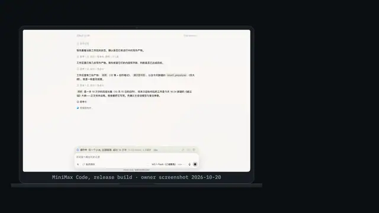 | **[Handset](skills/keynote-video/references/modes/handset.md)** | One device, locked off: every change happens on its screen, which shows only real captures — the product's pages, its UI, its docs — pushed in under the zoom cap, with the words in the margin level with the evidence | Launches that can be seen on the product's own surface: a new default in an app, a panel, a price, a line in the docs |
| 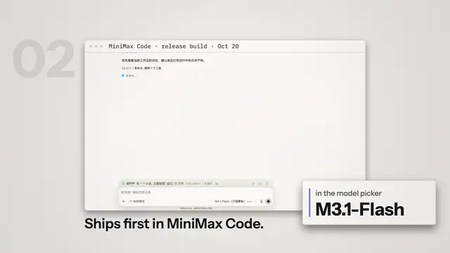 | **[Exhibit](skills/keynote-video/references/modes/exhibit.md)** | Real screenshots and charts on a desk under an overhead camera, in three planes (index numbers, the prints, a chip with each print's claim): the camera slides along the row with parallax, pulls back over the whole desk, cuts on a number two sources share, and measures the gap on a chart's own axis | Launches and reports whose claims are printed in tables, charts and product UI |
| 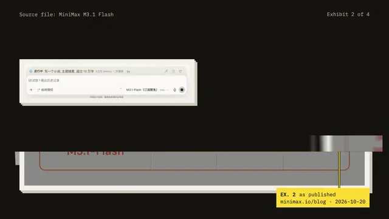 | **[Dossier](skills/keynote-video/references/modes/dossier.md)** | Real pages dealt onto a dark mat like an evidence file: a highlighter strikes each claim where it is printed, a leader ties it to an exhibit sticker with the source and date, and a figure is carried as a paper slip onto a worksheet that does the arithmetic | Launches, reports and changelogs whose claims are already published |
| 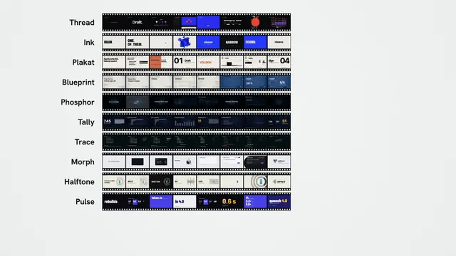 | **[Strip](skills/keynote-video/references/modes/strip.md)** | One strip of film through a fixed gate on a light box: real frames of real films stop registered one a beat, a frame punches to a contact sheet whose rows are exactly as long as the films, and a grease pencil rings the take that runs | Reels of a product's real outputs: rendered films, footage, frames to choose from |
| 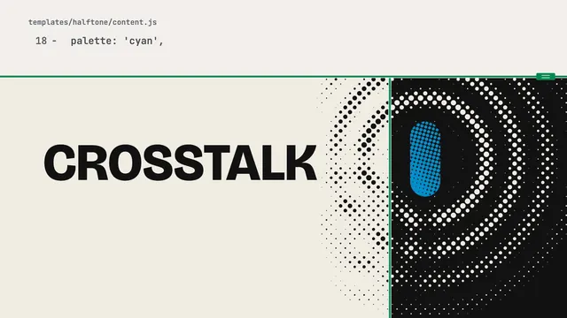 | **[Split](skills/keynote-video/references/modes/split.md)** | One movable seam divides the frame: what is written on paper on one side, the real frames, renders and reports it makes on the other; every change is a move of the seam, and the climax is one changed line over two renders of the same instant | Developer tools whose input maps line by line to an output: generators, configs, CLIs and their reports |
| 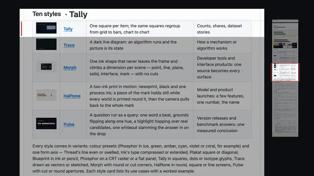 | **[Scroll](skills/keynote-video/references/modes/scroll.md)** | The product's own long page as one paper scroll: flicked up with momentum, it brakes and locks section by section while its headings pin as chapters; an underline marks the line being read and a band repeats it in large type; one row unfolds in place on the demo it describes | Launches told by the product's own README, docs or changelog |
| 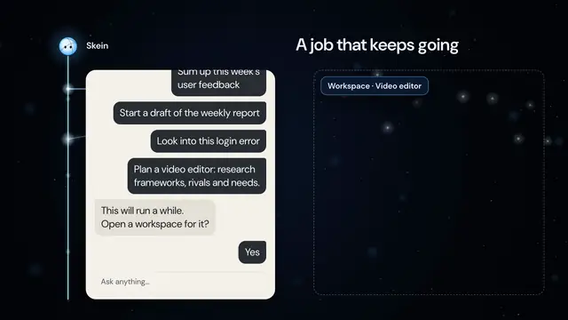 | **[Stream](skills/keynote-video/references/modes/stream.md)** | One thread of light through a night sky: it pierces a scattered desk and reels it in, small interface blocks hang on it, each task leaves as a star, a job's stars link into a constellation, and one sweep gathers every star into the one panel where one thing needs you; on-screen text in English or Chinese | Agent desks and task schedulers: work sent out, run in parallel, checked and brought back |

Every style comes in variants: colour presets (Phosphor in ice, green, amber, cyan, violet or coral, for example) and one form axis — Thread's line even or swelled, Ink's type compressed or extended, Plakat square or diagonal, Blueprint in ink or pencil, Phosphor on a CRT raster or a flat panel, Tally in squares, dots or Isotype glyphs, Trace drawn as vectors or sketched, Morph with round or cut corners, Halftone in round, square or line screens, Pulse with cut or round apertures, Handset on a laptop or a phone, Exhibit on a plain desk or a cutting mat, Dossier's highlighter over the claim or under the line, Strip on double- or single-perforation film, Split's seam straight or stitched, Scroll with or without a minimap of the whole page, Stream opening on a desktop or in the night sky. Each style card lists its use cases with a worked example.

### Any agent, any model

keynote-video asks very little of the agent that runs it, so it is not tied to one agent or one model:

- **A shell, Node.js and FFmpeg.** No agent-specific tools, plugins or APIs: the skill is plain Markdown and JavaScript, so any agent that can read files and run commands can follow it.
- **No generation model.** Pictures are drawn in code and sound is synthesised in code. Nothing calls an image, video or music model, so a film needs no API key and costs nothing per render; a generated music bed is optional.
- **The template does the heavy lifting.** Every style starts as a working film. The agent writes one `content.js`; the scripts fit the timing to the beat, mix the sound and measure the render. A fast model can carry a film from brief to measured MP4, not only a large one.

### Quick start

Install it as shown in [Install](#install), or send this to any coding agent that has a shell:

```text
Install the keynote-video skill: clone https://github.com/coder-xieshijie/filmsmith, link its skills/keynote-video folder into your skills folder as keynote-video, then run `node scripts/selftest.mjs --modes ink` inside that folder and tell me the result.
```

To update later:

```text
Update the keynote-video skill: git pull in the filmsmith clone, then run `node scripts/selftest.mjs --modes ink` in skills/keynote-video and tell me the latest commit.
```

Then, in a new session:

> Use keynote-video. Make a launch video for &lt;your project&gt;. Source: &lt;link or text&gt;.

More things to ask for:

```text
Make a 30-second teaser for our CLI's 2.0 release; the changelog is in CHANGELOG.md.
Turn the numbers in data/survey.csv into a 40-second data film.
Explain how our rate limiter works, step by step, as a 45-second film; the code is in src/limiter.
Restyle last week's launch film as a blueprint and compare the two.
```

The agent proposes a style and a palette, writes a plan, renders key frames for you to check, renders the film and measures it. Under the hood, from the folder that holds the clone:

```bash
node filmsmith/skills/keynote-video/scripts/new-film.mjs ink my-film --palette cobalt   # scaffold a film from a style
cd my-film && npm run film                                                              # fit → audio → check → render
node ../filmsmith/skills/keynote-video/scripts/check-film.mjs renders/film.mp4 --film-dir .
```

Requirements: Node.js 22+, FFmpeg, and network access while a film is set up (fonts, GSAP, the first HyperFrames run). `node scripts/selftest.mjs` in `skills/keynote-video` checks your machine and all seventeen templates.

### How a film is made

```
theory of taste ──▶ ten principles ──▶ seventeen styles ──▶ template + content.js ──▶ npm run film ──▶ measured MP4
(foundations.md)    (principles.md)    (modes/)              (assets/templates/)        (HyperFrames)    (check-film)
```

- **Theory first.** A six-layer pyramid of good design (legible → clear → flowing → unified → fitting → fresh) gives ten core principles; every style rule and checklist item traces back to them, and where the author's taste and the theory disagree, the theory wins.
- **Styles, not blank pages.** A new film starts from a working film: pick a style, replace the copy, keep the choreography.
- **All code.** Pictures are drawn with HTML, canvas, WebGL and GSAP on HyperFrames; sound is synthesised on the same beat grid, and a generated music bed can replace it.
- **Brisk and clean.** Length follows the content, and the picture keeps changing: a small change about every beat, a new composition every 2–3 s, an expressive transition every 8–12 s, two or three peaks; at most five words enter at once, so the reading floor holds; every key moment lands on the beat.
- **Transitions as a library.** Fifty object-level hand-offs (one object carried from scene to scene: a word, a ringed number, a long page, a strip of film, a seam) and seventeen frame-level transitions, each with the theory it rests on, grouped by the axis they move on.
- **Measured.** `check-film` reports format, loudness (−14 LUFS), flashes by area (WCAG 2.3.1), black frames, beat sync of key events, stillness, the four tiers of pace and hand-offs.

### Limits

- Landscape 16:9 at 1920×1080 only.
- On-screen text is English; only Stream also sets Chinese.

## teach-video

[`skills/teach-video`](skills/teach-video/SKILL.md) makes Chinese explainer films that teach one technical idea to developers who know the basics, drawn in code (HyperFrames) from a style kit: one command turns a narration script into voice, timeline and word timestamps; a director splits the film into 2–3 segments with hand-off contracts; geometry gates and a ~20-image review packet replace eyeballing; the presenter records the voice-over at the end.

```bash
npx skills add coder-xieshijie/filmsmith --skill teach-video
```

## What's here

| | |
|---|---|
| [`skills/keynote-video/`](skills/keynote-video/SKILL.md) | The keynote-video skill: workflow, theory, principles, the seventeen styles and their templates, the transition library, the runtime and the measuring scripts |
| [`skills/teach-video/`](skills/teach-video/SKILL.md) | The teach-video skill |
| [`docs/`](docs/) | Images for this README and the repository's social preview |
| [CHANGELOG.md](CHANGELOG.md) | Changes to every skill |

## License

Code, skills and prompts are under the [MIT License](LICENSE). Fonts, GSAP and HyperFrames are downloaded at setup under their own licences: see [THIRD-PARTY.md](THIRD-PARTY.md). Contributions: [CONTRIBUTING.md](CONTRIBUTING.md).
