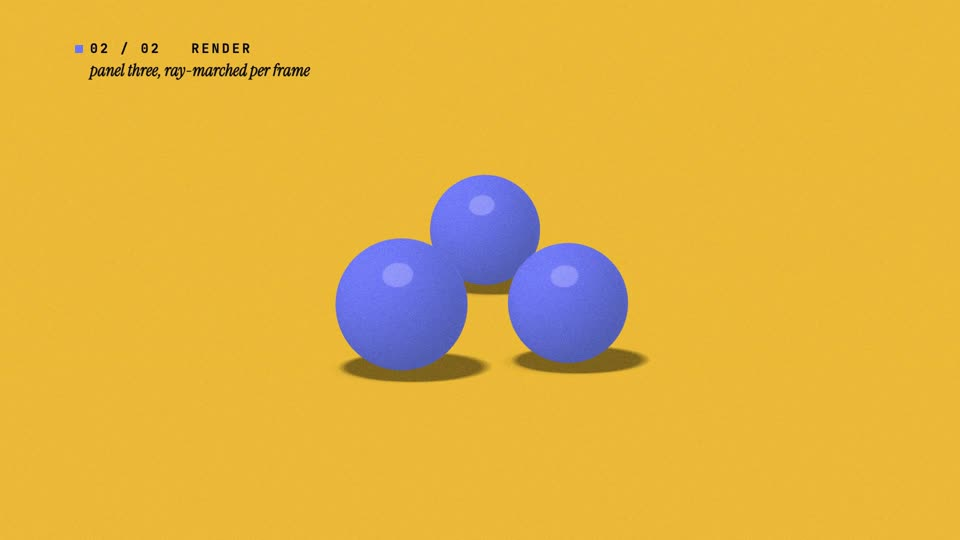
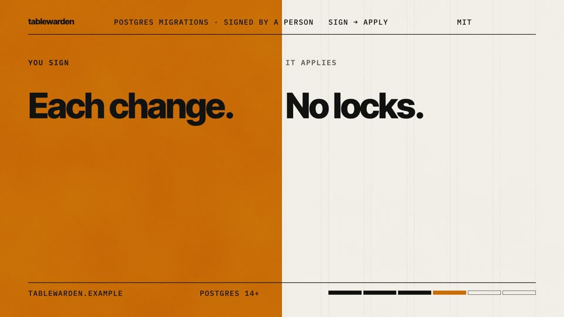
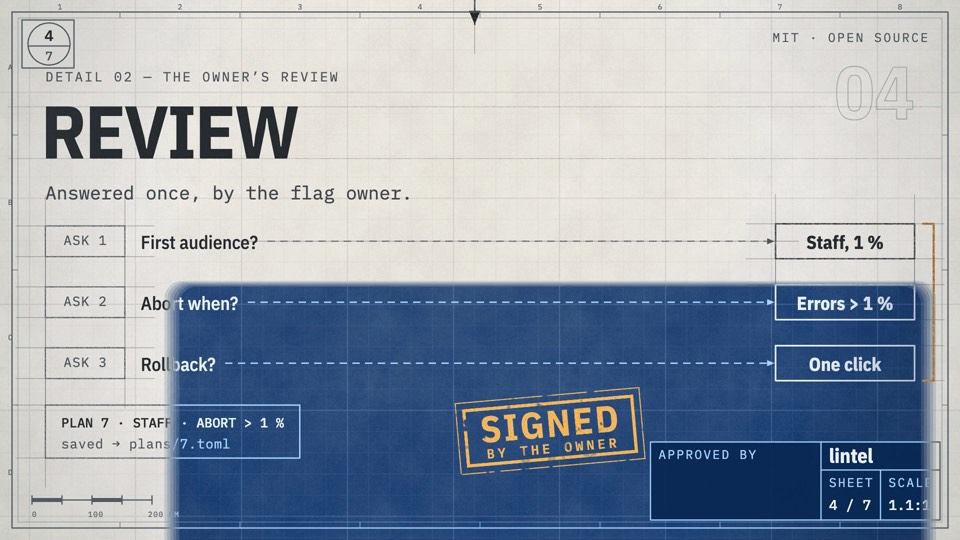
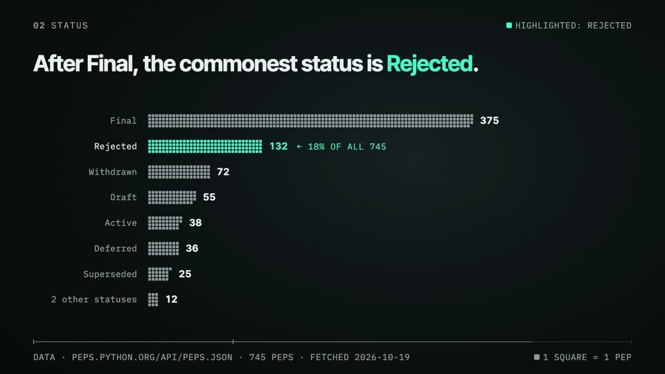
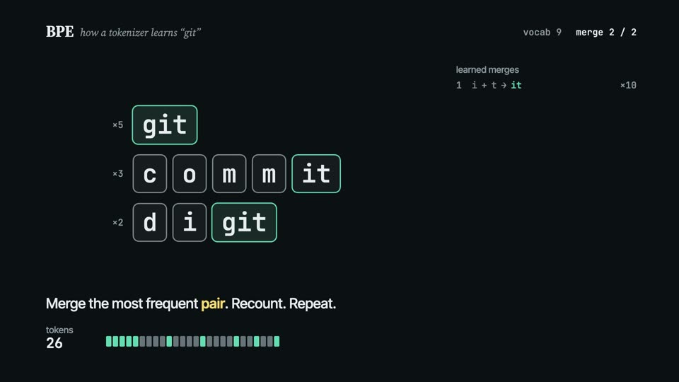
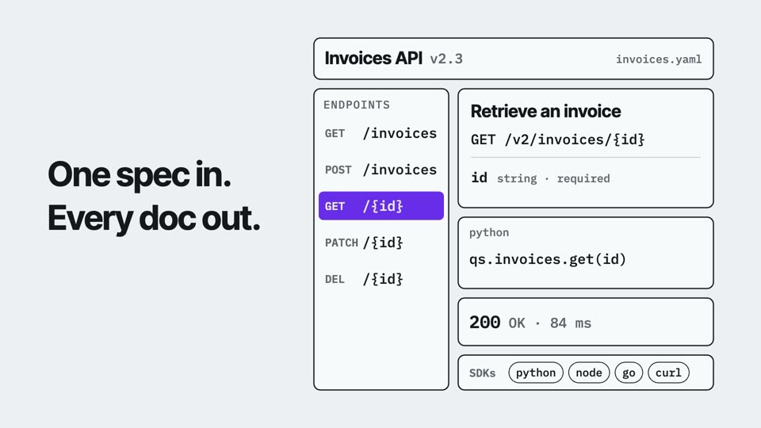
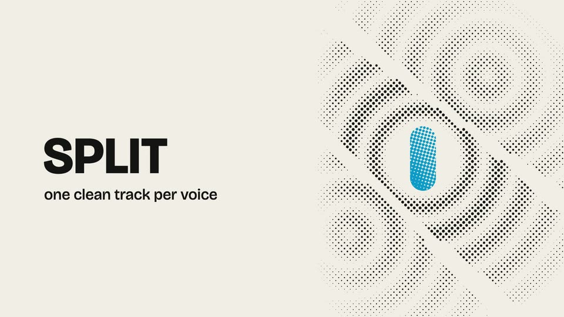

# Filmsmith · 片匠


English | [简体中文](README.zh-CN.md)

**Ten ways to film your code.**

Filmsmith is an agent skill that makes short technical films — launches, teasers, showreels, data stories, explainers — with every frame drawn in code and every sound synthesised in code. Pick a style, fill one file, render. It runs in any coding agent that can use a shell.


## Ten styles

Each style is one visual language with palette presets, one form variant, a scene registry and a template that renders a complete film. Stills are from each style's example film.

| | Style | Looks like | Best for |
|---|---|---|---|
|  | **[Thread · 一线](references/modes/thread.md)** | One line that becomes everything in turn — caret, swatches, storyboard, glossy spheres, edit tracks — with no cuts | Showreels of a video, motion or rendering tool |
|  | **[Ink · 落墨](references/modes/ink.md)** | Heavy type slammed on every beat; an ink drop unfurls like sumi in water and floods the frame with colour | Name reveals, launch stings, one-line claims |
|  | **[Plakat · 招贴](references/modes/plakat.md)** | International-style posters in motion: paper, ink, one signal colour, a visible 12-column grid | A claim plus steps, and the person who decides |
|  | **[Blueprint · 蓝图](references/modes/blueprint.md)** | One engineering drawing drafted sheet by sheet; amber stamps approve each part | Systems and workflows with parts and sign-offs |
|  | **[Phosphor · 荧屏](references/modes/phosphor.md)** | A night-time terminal running a launch: one phosphor accent, light drawn in code, a HUD frame | CLIs and developer tools |
|  | **[Tally · 算筹](references/modes/tally.md)** | One square per item; the same squares regroup from grid to bars, chart to chart | Counts, shares, dataset stories |
|  | **[Trace · 演算](references/modes/trace.md)** | A dark live diagram: an algorithm runs and the picture is its state | How a mechanism or algorithm works |
|  | **[Morph · 一笔](references/modes/morph.md)** | One ink shape that never leaves the frame and climbs a dimension per scene — point, line, plane, solid, interface, mark — with no cuts | Developer tools and interface products: one source becomes every surface |
|  | **[Halftone · 网点](references/modes/halftone.md)** | A two-ink print in motion: newsprint, black and one process ink; a piece of the mark holds still while every world is printed round it, then the camera pulls back to the whole mark | Model and product launches: a few features, one number, the name |
|  | **[Pulse · 节拍](references/modes/pulse.md)** | A question run as a query: one word a beat, grounds flipping along one hue, a highlight hopping over real candidates, one whiteout slamming the answer in on the drop | Version releases and benchmark answers: one measured conclusion |

Every style comes in variants: colour presets (Phosphor in ice, green, amber, cyan or violet, for example) and one form axis — Thread's line even or swelled, Ink's type compressed or extended, Plakat square or diagonal, Blueprint in ink or pencil, Phosphor on a CRT raster or a flat panel, Tally in squares, dots or Isotype glyphs, Trace drawn as vectors or sketched, Morph with round or cut corners, Halftone in round, square or line screens, Pulse with cut or round apertures. Each style card lists its use cases with a worked example.

## Quick start

Install the skill (the [skills CLI](https://github.com/vercel-labs/skills) asks which agents to install it for; observed 2026-10):

```bash
npx skills add coder-xieshijie/filmsmith
```

Or send this to any coding agent that has a shell:

```text
Install the filmsmith skill: clone https://github.com/coder-xieshijie/filmsmith into your skills folder as filmsmith, then run `node scripts/selftest.mjs --modes ink` inside it and tell me the result.
```

To update later:

```text
Update the filmsmith skill: git pull in its folder, then run `node scripts/selftest.mjs --modes ink` and tell me the latest commit.
```

Or clone and link it yourself:

```bash
git clone https://github.com/coder-xieshijie/filmsmith.git
ln -s "$PWD/filmsmith" <your agent's skills folder>/filmsmith
```

Then, in a new session:

> Use filmsmith. Make a launch video for &lt;your project&gt;. Source: &lt;link or text&gt;.

More things to ask for:

```text
Make a 30-second teaser for our CLI's 2.0 release; the changelog is in CHANGELOG.md.
Turn the numbers in data/survey.csv into a 40-second data film.
Explain how our rate limiter works, step by step, as a 45-second film; the code is in src/limiter.
Restyle last week's launch film as a blueprint and compare the two.
```

The agent proposes a style and a palette, writes a plan, renders key frames for you to check, renders the film and measures it. Under the hood:

```bash
node filmsmith/scripts/new-film.mjs ink my-film --palette cobalt   # scaffold a film from a style
cd my-film && npm run film                                            # fit → audio → check → render
node ../filmsmith/scripts/check-film.mjs renders/film.mp4 --film-dir .
```

Requirements: Node.js 22+, FFmpeg, and network access while a film is set up (fonts, GSAP, the first HyperFrames run). `node scripts/selftest.mjs` checks your machine and all ten templates.

## How a film is made

```
theory of taste ──▶ ten principles ──▶ ten styles ──▶ template + content.js ──▶ npm run film ──▶ measured MP4
(foundations.md)    (principles.md)    (modes/)         (assets/templates/)        (HyperFrames)    (check-film)
```

- **Theory first.** A six-layer pyramid of good design (legible → clear → flowing → unified → fitting → fresh) gives ten core principles; every style rule and checklist item traces back to them, and where the author's taste and the theory disagree, the theory wins.
- **Styles, not blank pages.** A new film starts from a working film: pick a style, replace the copy, keep the choreography.
- **All code.** Pictures are drawn with HTML, canvas, WebGL and GSAP on [HyperFrames](https://github.com/heygen-com/hyperframes); sound is synthesised on the same beat grid, and a generated music bed can replace it.
- **Brisk and clean.** Length follows the content, and the picture keeps changing: a small change about every beat, a new composition every 2–3 s, an expressive transition every 8–12 s, two or three peaks; at most five words enter at once, so the reading floor holds; every key moment lands on the beat.
- **Transitions as a library.** Twenty object-level hand-offs (one object carried from scene to scene) and frame-level transitions, each with the theory it rests on.
- **Measured.** `check-film` reports format, loudness (−14 LUFS), flashes by area (WCAG 2.3.1), black frames, beat sync of key events, stillness, the four tiers of pace and hand-offs.

## What's here

| | |
|---|---|
| [Skill](SKILL.md) | `filmsmith`: the workflow, theory, principles, the ten styles and their templates, the transition library, the runtime and the measuring scripts. |

## Limits

- Landscape 16:9 at 1920×1080 only.
- On-screen text is English in this version.
- The synthesised music has been measured, not yet signed off by ear.

## License

Code, skill and prompts are under the [MIT License](LICENSE). Fonts, GSAP and HyperFrames are downloaded at setup under their own licences: see [THIRD-PARTY.md](THIRD-PARTY.md). Contributions: [CONTRIBUTING.md](CONTRIBUTING.md).
