# 片匠 Filmsmith


[English](README.md) | 简体中文

**十六种拍代码的方法。**

Filmsmith 是一个 Agent Skill，用来做技术短片：发布片、预告、showreel、数据片、讲解片。每一帧画面都由代码绘制，每一个声音都由代码合成。选一种风格，填一个文件，渲染即可。任何能跑 shell 的编码 Agent 都能用。

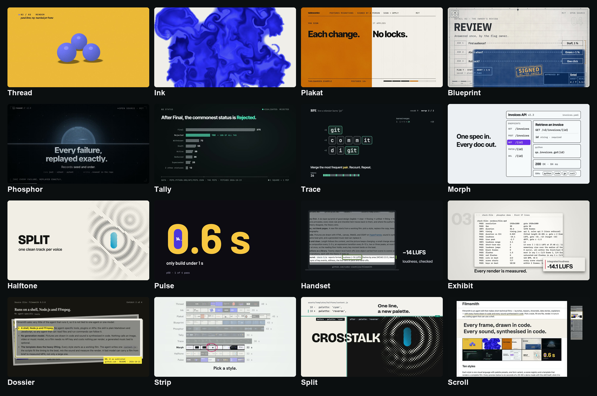

## 十六种风格

每种风格是一套视觉语言：配色预设、一个形态变体、登记好的场景库，以及一个能直接渲出完整成片的模板。下面每张动图取自现成的 28–46 秒 demo，时长均为 6 秒。前十支完整成片已在 [YouTube](https://www.youtube.com/@world_0618) 公开，MP4 下载在 [v0.1.0 Release](https://github.com/coder-xieshijie/filmsmith/releases/tag/v0.1.0)；六支真实素材 demo 正待上传。

前十支的产品都是虚构的，只有 Tally 用的是真实的 Python PEP 索引。Handset、Exhibit、Dossier 演示 2026-10-20 留存的真实发布页、图表和产品界面；Strip、Split、Scroll 使用 2026-10-21 留存的 Filmsmith 成片、代码与仓库页面。片中的数字、活动与十种风格 README 属于当时的来源快照。总览图展示目前十六种风格，保留的 demo 可能使用较早的配色预设。

| | 风格 | 看起来 | 最适合 |
|---|---|---|---|
| <a href="https://youtu.be/jqZYCnO05oc"></a> | **[Thread](references/modes/thread.md)** | 一根线依次变成一切：光标、色板、分镜、光泽小球、剪辑轨道，全片不切 | 视频、动效、渲染工具的 showreel |
| <a href="https://youtu.be/lROE42KoS0Q"></a> | **[Ink](references/modes/ink.md)** | 粗重的字随节拍砸在纸上；一滴墨像入水的墨汁那样卷开，铺满整屏颜色 | 名字揭晓、发布片头、一句话主张 |
| <a href="https://youtu.be/UFWodFOugnc">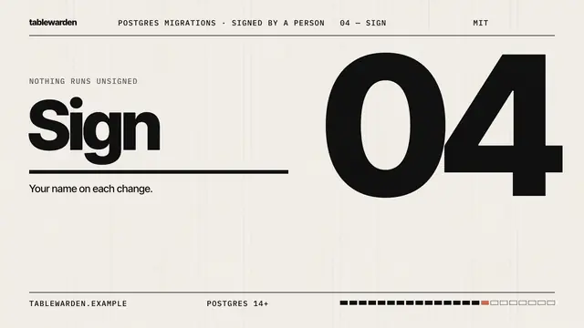</a> | **[Plakat](references/modes/plakat.md)** | 会动的国际主义海报：纸、油墨、一个信号色，12 栏网格始终可见 | 一个主张加几个步骤，以及拍板的人 |
| <a href="https://youtu.be/hEbEtFNLL0w">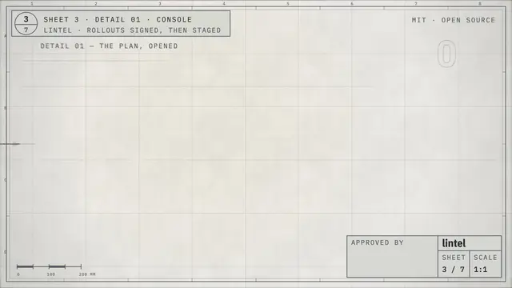</a> | **[Blueprint](references/modes/blueprint.md)** | 一张工程图纸逐张绘制，琥珀色印章逐项批准 | 有部件、有签字环节的系统与流程 |
| <a href="https://youtu.be/UMG08KZZ6IM">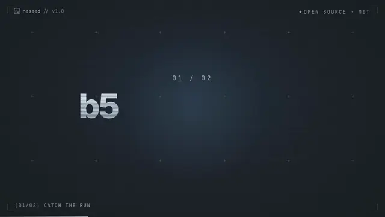</a> | **[Phosphor](references/modes/phosphor.md)** | 深夜终端里的发布会：一个荧光强调色、代码画出的光、HUD 边框 | CLI 与开发者工具 |
| <a href="https://youtu.be/KPMS7Bgpflg">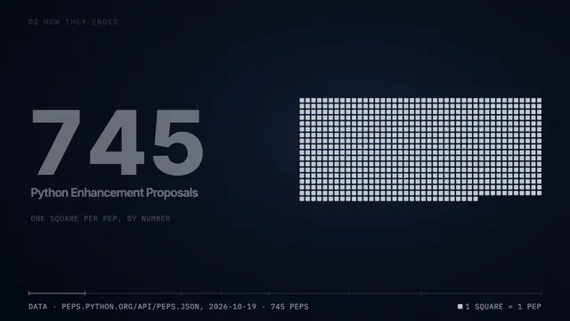</a> | **[Tally](references/modes/tally.md)** | 一个方块代表一条数据；同一批方块从网格重组成条形，一图接一图 | 计数、占比、数据集故事 |
| <a href="https://youtu.be/QjjP1WhNm8w">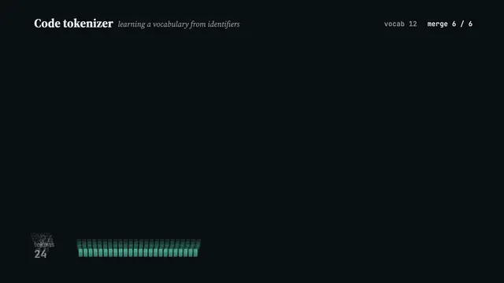</a> | **[Trace](references/modes/trace.md)** | 深色的实时图解：算法在运行，画面就是它的状态 | 机制和算法是怎么工作的 |
| <a href="https://youtu.be/0AYkyN_dv_Q">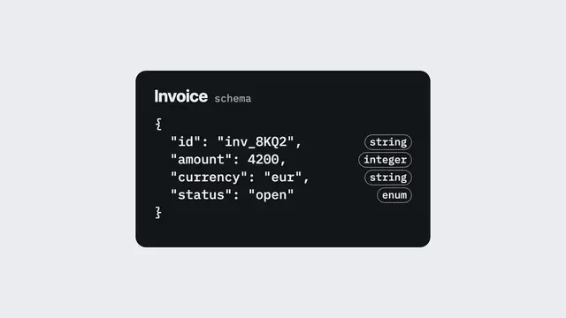</a> | **[Morph](references/modes/morph.md)** | 一个形从头到尾不离开画面，每场升一个维度：点、线、面、体、界面、标志，全片不切 | 开发工具和界面产品：一个源头变成整个产品 |
| <a href="https://youtu.be/raqJMXgK4vU">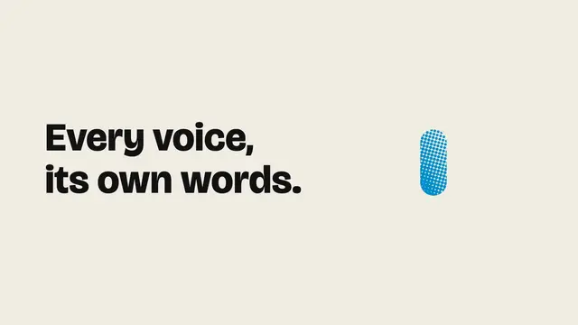</a> | **[Halftone](references/modes/halftone.md)** | 会动的双墨印刷：新闻纸、黑版和一种印刷色；取自标志的一小块始终不动，周围的世界一个个印出来，最后拉远露出整个标志 | 模型和产品发布：几个特性、一个数字、一个名字 |
| <a href="https://youtu.be/XrFmTVEyi94">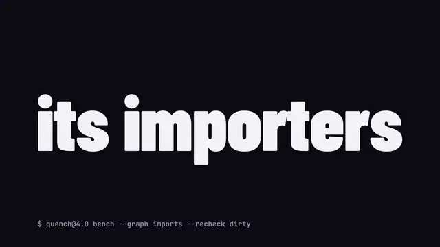</a> | **[Pulse](references/modes/pulse.md)** | 把一个问题演成一次查询：一拍一个词，底色在一个色相的明度阶上翻转，高亮在真实候选间跳，答案随一次闪白砸进来 | 版本发布、基准测试的答案：一个测出来的结论 |
| 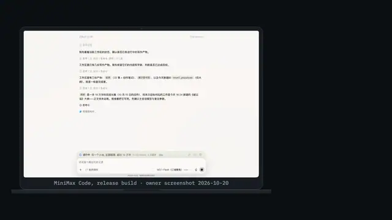 | **[Handset](references/modes/handset.md)** | 一台正面放着、机位不动的设备，所有变化都发生在它的屏幕上；屏幕里只放真实截图（产品页面、界面、文档），推近不超过缩放上限，文字在右侧留白里和证据对齐 | 能在产品自己界面上看见的发布：应用里换了默认、多了一个面板、价格页、文档里的一句话 |
| 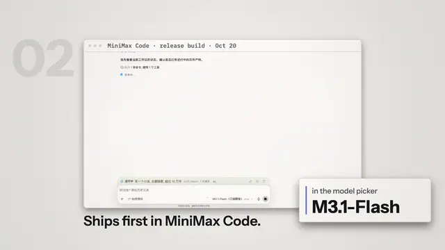 | **[Exhibit](references/modes/exhibit.md)** | 真实截图和图表放在桌面上，相机从正上方俯拍，分三层：后面是编号，中间是装裱好的截图，前面是写着每张截图主张的标签；相机带视差沿着一排滑过去、拉远看整张桌面再跳到另一张、在两份来源共有的数字上切过去，最后在图表自己的坐标轴上量出差距 | 主张印在表格、图表和产品界面里的发布与报告 |
| 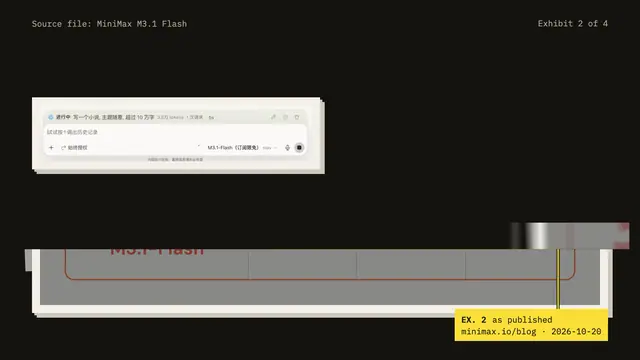 | **[Dossier](references/modes/dossier.md)** | 真实网页像证据卷宗一样一页页发到深色台面上：荧光笔在原文印着的地方划出每条主张，引线连到写着来源和截取日期的证物标签，一个数字像纸条一样被剪下来，带到算草纸上算出结果 | 主张已经公开发布的发布、报告和更新日志 |
| 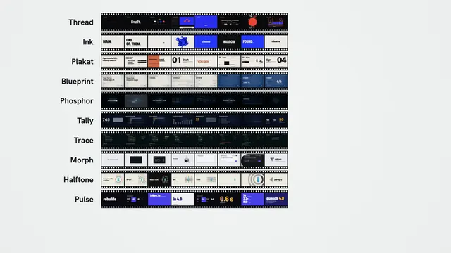 | **[Strip](references/modes/strip.md)** | 灯箱上的一条胶片穿过固定的片门：真实影片的真实画格一拍一格地拉进片门、停稳对齐，一格冲到全屏后缩进印样，印样每一行和影片一样长，剪辑师的油性笔圈出选中的那一格，让它跑起来 | 产品真实产出的合集：渲染出的影片、实拍素材、可供挑选的画面 |
| 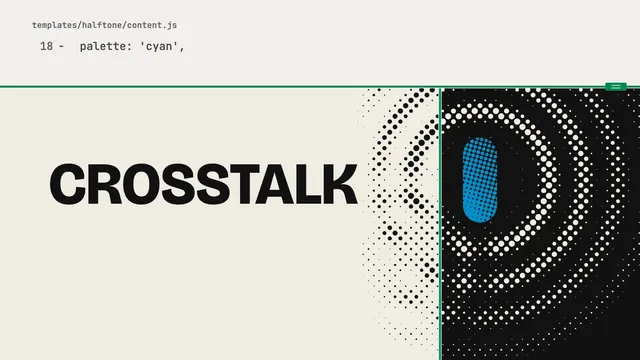 | **[Split](references/modes/split.md)** | 一条可移动的分割线把画面分成两边：一边是写在纸面上的输入（请求、真实文件里的几行、命令、一行 diff），另一边是它产出的真实画面、渲染和报告；每次变化都是分割线在动，高潮是改一行代码，同一时刻的两帧渲染分在线的两侧 | 输入能逐行对应到产出的开发者工具：生成器、配置、命令行工具和它们的报告 |
| 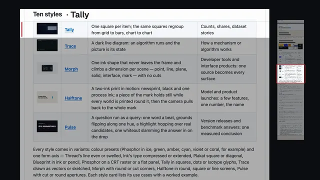 | **[Scroll](references/modes/scroll.md)** | 把产品自己的长页面当成一张纸卷轴：向上一甩带着惯性滑动，一节一节刹住、锁定，页面自己的标题钉在顶部当章节；一条下划线标出正在读的那一行，旁边的引文条用大字重复它；表格里的一行在原地展开，播放它所描述的那支演示片 | 用产品自己的 README、文档或更新日志讲的发布 |

每种风格都有变体。一是配色预设，例如 Phosphor 有冰白、绿、琥珀、青、紫、珊瑚红六套；二是一条形态轴：Thread 的线可以等宽或膨线，Ink 的字可以压缩或扩展，Plakat 可以方正或斜向，Blueprint 可以是针管笔或铅笔，Phosphor 可以是 CRT 扫描线或平板，Tally 可以用方块、圆点或 Isotype 图形符号，Trace 可以是矢量或手绘，Morph 可以是圆角或切角，Halftone 可以是圆点、方点或线网，Pulse 的光圈可以是切角或圆形，Handset 的设备可以是笔记本或手机，Exhibit 的桌面可以是素面或切割垫，Dossier 的荧光笔可以盖在主张上或划在行下，Strip 的胶片可以是双排齿孔或单排齿孔，Split 的分割线可以是实线或虚线（裁切线），Scroll 可以带或不带整页的缩略导航条。每张风格卡都列出适用场景，并附具体例子。

## 任何 Agent，任何模型

Filmsmith 对运行它的 Agent 要求很少，所以不绑定某一个 Agent 或某一个模型：

- **一个 shell，加上 Node.js 和 FFmpeg。** 不依赖任何 Agent 专属的工具、插件或 API：Skill 本身就是 Markdown 和 JavaScript，能读文件、能跑命令的 Agent 都能照着做。
- **不调用生成模型。** 画面由代码绘制，声音由代码合成，不调用任何图像、视频或音乐模型，所以不需要 API key，每次渲染也没有费用；生成的音乐床只是可选项。
- **重活由模板承担。** 每种风格一开始就是一支能跑的成片。Agent 只写一个 `content.js`，脚本负责把时间对齐到节拍、混音和测量成片。不只大模型，快模型也能把一支片从需求做到测量过的 MP4。

## 快速开始

安装 Skill（[skills CLI](https://github.com/vercel-labs/skills) 会问装给哪些 Agent；2026-10 实测）：

```bash
npx skills add coder-xieshijie/filmsmith
```

也可以直接把这段话发给有 shell 权限的编码 Agent：

```text
帮我安装 filmsmith skill：把 https://github.com/coder-xieshijie/filmsmith 克隆到你的 skills 目录，目录名叫 filmsmith；装好后在里面运行 `node scripts/selftest.mjs --modes ink`，告诉我结果。
```

以后更新：

```text
帮我更新 filmsmith skill：进入它的目录执行 git pull，再运行 `node scripts/selftest.mjs --modes ink`，告诉我最新的 commit。
```

或者自己 clone 再链接：

```bash
git clone https://github.com/coder-xieshijie/filmsmith.git
ln -s "$PWD/filmsmith" <你的 Agent 的 skills 目录>/filmsmith
```

然后在新会话里说：

> 用 filmsmith，给 <你的项目> 做一支发布片。资料：<链接或文字>。

也可以试这些：

```text
给我们 CLI 的 2.0 版本做一支 30 秒预告，更新内容在 CHANGELOG.md。
把 data/survey.csv 里的数字做成一支 40 秒的数据片。
用 45 秒一步步讲清楚我们的限流器是怎么工作的，代码在 src/limiter。
把上周那支发布片换成 Blueprint 风格重做一版，两版对比给我看。
```

Agent 会推荐风格和配色、写好计划、先出关键帧给你看，再渲染成片并测量。背后是这几条命令：

```bash
node filmsmith/scripts/new-film.mjs ink my-film --palette cobalt   # 从一种风格建工程
cd my-film && npm run film                                            # 定长 → 配乐 → 检查 → 渲染
node ../filmsmith/scripts/check-film.mjs renders/film.mp4 --film-dir .
```

环境要求：Node.js 22+、FFmpeg；建工程时需要联网（字体、GSAP、第一次运行 HyperFrames）。`node scripts/selftest.mjs` 可以检查本机环境和全部十六个模板。

## 一支片怎么做出来

```
品味理论 ──▶ 十条原则 ──▶ 十六种风格 ──▶ 模板 + content.js ──▶ npm run film ──▶ 测量过的 MP4
(foundations.md) (principles.md) (modes/)  (assets/templates/)     (HyperFrames)    (check-film)
```

- **理论先行。** 好设计的六层金字塔（看得清 → 看得懂 → 看得顺 → 成一体 → 合身 → 新鲜）推出十条核心原则，每条风格规则和检查项都能追溯到它们；作者的品味和理论冲突时，以理论为准。
- **从风格出发，不从白纸出发。** 新片从一支能跑的片子开始：选风格、换文案，编舞保留。
- **全部是代码。** 画面用 HTML、canvas、WebGL 和 GSAP 在 [HyperFrames](https://github.com/heygen-com/hyperframes) 上绘制；声音在同一套节拍网格上合成，也可以换成生成的配乐。
- **轻快、干净。** 片长由内容决定，画面一直在变：约每拍一个小变化，每 2–3 秒换一次构图，每 8–12 秒一次表现型转场，全片两三个高峰；一次最多进场五个词，读字时间不打折；关键时刻都落在拍上。
- **转场成库。** 五十个对象级交接件（同一个东西从上一场带到下一场：一个词、一个圈出的数字、一张长页、一条胶片、一条分屏线）和十七个帧级转场，每个都写明依据的理论，并按运动方向分好家族。
- **每次都测。** `check-film` 检查格式、响度（−14 LUFS）、按面积计的闪烁（WCAG 2.3.1）、黑帧、关键事件是否在拍上、静止时长、节奏四档和交接。

## 仓库里有什么

| | |
|---|---|
| [Skill](SKILL.md) | `filmsmith`：流程、理论、原则、十六种风格及其模板、转场库、运行库和测量脚本。 |

## 限制

- 只做横屏 16:9、1920×1080。
- 这一版画面文字只有英文。

## 许可

代码、Skill 和提示词采用 [MIT License](LICENSE)。字体、GSAP 和 HyperFrames 在建工程时下载，各自遵循自己的许可，见 [THIRD-PARTY.md](THIRD-PARTY.md)。参与贡献见 [CONTRIBUTING.md](CONTRIBUTING.md)。
