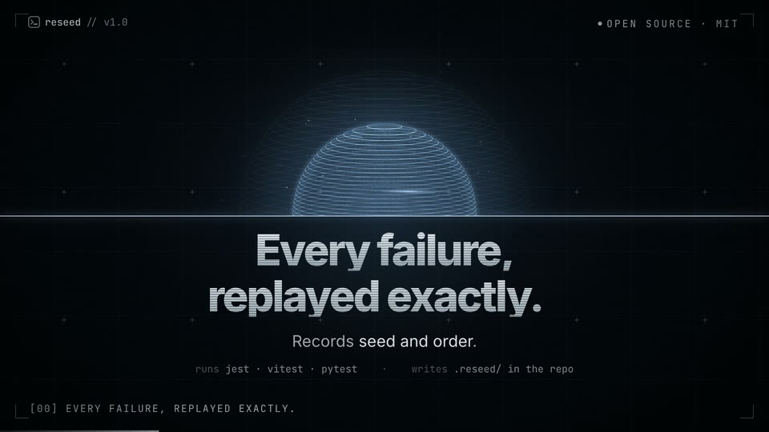
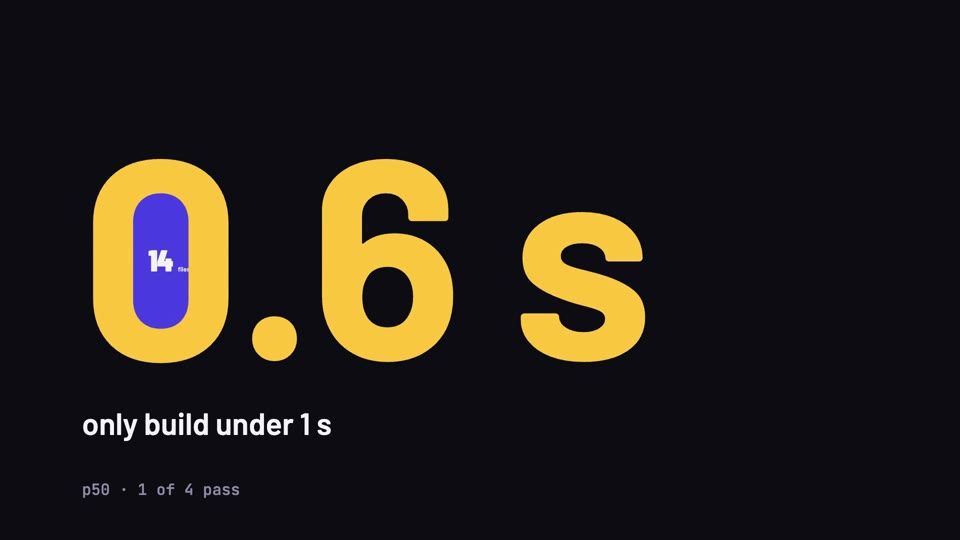

# Filmsmith · 片匠

[English](README.md) | 简体中文

**十种拍代码的方法。**

Filmsmith 是一个 Agent Skill，用来做技术短片：发布片、预告、showreel、数据片、讲解片。每一帧画面都由代码绘制，每一个声音都由代码合成。选一种风格，填一个文件，渲染即可。任何能跑 shell 的编码 Agent 都能用。

## 十种风格

每种风格是一套视觉语言：配色预设、一个形态变体、登记好的场景库，以及一个能直接渲出完整成片的模板。截图取自各风格的示例片。

| | 风格 | 看起来 | 最适合 |
|---|---|---|---|
|  | **[一线 · Thread](skills/filmsmith/references/modes/thread.md)** | 一根线依次变成一切：光标、色板、分镜、光泽小球、剪辑轨道，全片不切 | 视频、动效、渲染工具的 showreel |
|  | **[落墨 · Ink](skills/filmsmith/references/modes/ink.md)** | 粗重的字随节拍砸在纸上；一滴墨像入水的墨汁那样卷开，铺满整屏颜色 | 名字揭晓、发布片头、一句话主张 |
|  | **[招贴 · Plakat](skills/filmsmith/references/modes/plakat.md)** | 会动的国际主义海报：纸、油墨、一个信号色，12 栏网格始终可见 | 一个主张加几个步骤，以及拍板的人 |
|  | **[蓝图 · Blueprint](skills/filmsmith/references/modes/blueprint.md)** | 一张工程图纸逐张绘制，琥珀色印章逐项批准 | 有部件、有签字环节的系统与流程 |
|  | **[荧屏 · Phosphor](skills/filmsmith/references/modes/phosphor.md)** | 深夜终端里的发布会：一个荧光强调色、代码画出的光、HUD 边框 | CLI 与开发者工具 |
|  | **[算筹 · Tally](skills/filmsmith/references/modes/tally.md)** | 一个方块代表一条数据；同一批方块从网格重组成条形，一图接一图 | 计数、占比、数据集故事 |
|  | **[演算 · Trace](skills/filmsmith/references/modes/trace.md)** | 深色的实时图解：算法在运行，画面就是它的状态 | 机制和算法是怎么工作的 |
|  | **[一笔 · Morph](skills/filmsmith/references/modes/morph.md)** | 一个形从头到尾不离开画面，每场升一个维度：点、线、面、体、界面、标志，全片不切 | 开发工具和界面产品：一个源头变成整个产品 |
|  | **[网点 · Halftone](skills/filmsmith/references/modes/halftone.md)** | 会动的双墨印刷：新闻纸、黑版和一种印刷色；取自标志的一小块始终不动，周围的世界一个个印出来，最后拉远露出整个标志 | 模型和产品发布：几个特性、一个数字、一个名字 |
|  | **[节拍 · Pulse](skills/filmsmith/references/modes/pulse.md)** | 把一个问题演成一次查询：一拍一个词，底色在一个色相的明度阶上翻转，高亮在真实候选间跳，答案随一次闪白砸进来 | 版本发布、基准测试的答案：一个测出来的结论 |

每种风格都有变体。一是配色预设，例如荧屏有冰白、绿、琥珀、青、紫五套；二是一条形态轴：一线的线可以等宽或膨线，落墨的字可以压缩或扩展，招贴可以方正或斜向，蓝图可以是针管笔或铅笔，荧屏可以是 CRT 扫描线或平板，算筹可以用方块、圆点或 Isotype 图形符号，演算可以是矢量或手绘，一笔可以是圆角或切角，网点可以是圆点、方点或线网，节拍的光圈可以是切角或圆形。每张风格卡都列出适用场景，并附具体例子。

## 快速开始

安装 Skill（[skills CLI](https://github.com/vercel-labs/skills) 会问装给哪些 Agent；2026-10 实测）：

```bash
npx skills add coder-xieshijie/filmsmith
```

或者 clone 下来，把目录链接进 Agent 的 skills 目录：

```bash
git clone https://github.com/coder-xieshijie/filmsmith.git
ln -s "$PWD/filmsmith/skills/filmsmith" <你的 Agent 的 skills 目录>/filmsmith
```

或者让 Agent 直接读 `skills/filmsmith/SKILL.md`。然后在新会话里说：

> 用 filmsmith，给 <你的项目> 做一支发布片。资料：<链接或文字>。

Agent 会推荐风格和配色、写好计划、先出关键帧给你看，再渲染成片并测量。背后是这几条命令：

```bash
node skills/filmsmith/scripts/new-film.mjs ink my-film --palette cobalt   # 从一种风格建工程
cd my-film && npm run film                                            # 定长 → 配乐 → 检查 → 渲染
node ../skills/filmsmith/scripts/check-film.mjs renders/film.mp4 --film-dir .
```

环境要求：Node.js 22+、FFmpeg；建工程时需要联网（字体、GSAP、第一次运行 HyperFrames）。`node skills/filmsmith/scripts/selftest.mjs` 可以检查本机环境和全部十个模板。

## 一支片怎么做出来

```
品味理论 ──▶ 十条原则 ──▶ 十种风格 ──▶ 模板 + content.js ──▶ npm run film ──▶ 测量过的 MP4
(foundations.md) (principles.md) (modes/)  (assets/templates/)     (HyperFrames)    (check-film)
```

- **理论先行。** 好设计的六层金字塔（看得清 → 看得懂 → 看得顺 → 成一体 → 合身 → 新鲜）推出十条核心原则，每条风格规则和检查项都能追溯到它们；作者的品味和理论冲突时，以理论为准。
- **从风格出发，不从白纸出发。** 新片从一支能跑的片子开始：选风格、换文案，编舞保留。
- **全部是代码。** 画面用 HTML、canvas、WebGL 和 GSAP 在 [HyperFrames](https://github.com/heygen-com/hyperframes) 上绘制；声音在同一套节拍网格上合成，也可以换成生成的配乐。
- **轻快、干净。** 片长由内容决定，画面一直在变：约每拍一个小变化，每 2–3 秒换一次构图，每 8–12 秒一次表现型转场，全片两三个高峰；一次最多进场五个词，读字时间不打折；关键时刻都落在拍上。
- **转场成库。** 二十个对象级交接件（同一个东西从上一场带到下一场）和帧级转场，每个都写明依据的理论。
- **每次都测。** `check-film` 检查格式、响度（−14 LUFS）、按面积计的闪烁（WCAG 2.3.1）、黑帧、关键事件是否在拍上、静止时长、节奏四档和交接。

## 仓库里有什么

| | |
|---|---|
| [Skill](skills/filmsmith/SKILL.md) | `filmsmith`：流程、理论、原则、十种风格及其模板、转场库、运行库和测量脚本。 |

## 限制

- 只做横屏 16:9、1920×1080。
- 这一版画面文字只有英文。
- 合成配乐做过测量，还没经人耳确认。

## 许可

代码、Skill 和提示词采用 [MIT License](LICENSE)。字体、GSAP 和 HyperFrames 在建工程时下载，各自遵循自己的许可，见 [THIRD-PARTY.md](THIRD-PARTY.md)。参与贡献见 [CONTRIBUTING.md](CONTRIBUTING.md)。
